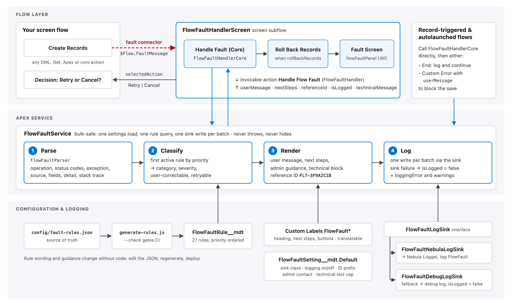
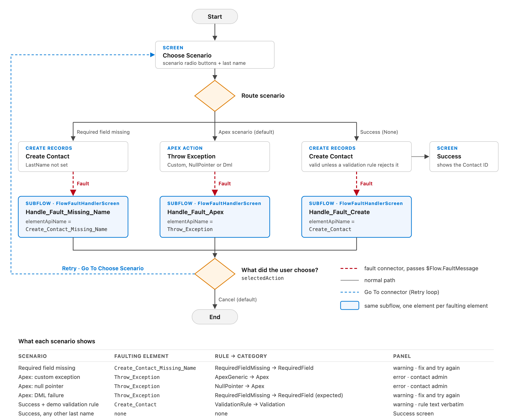
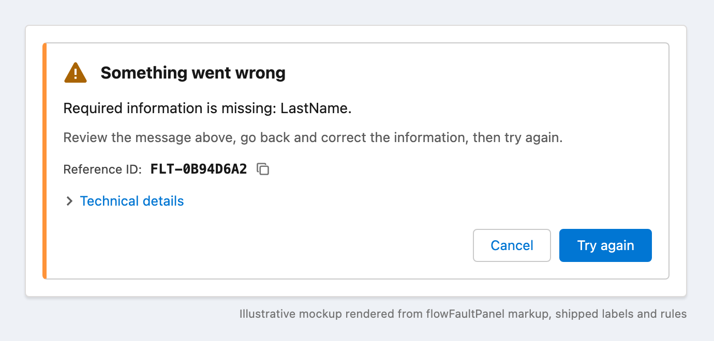
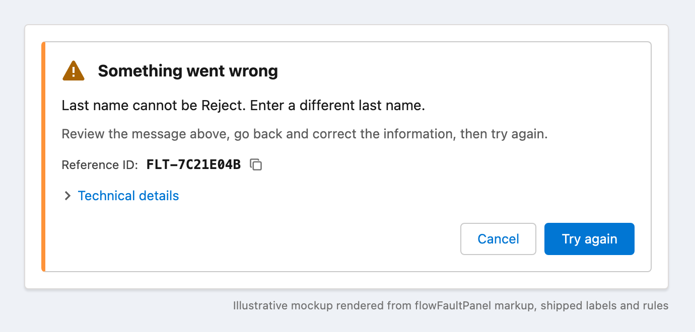
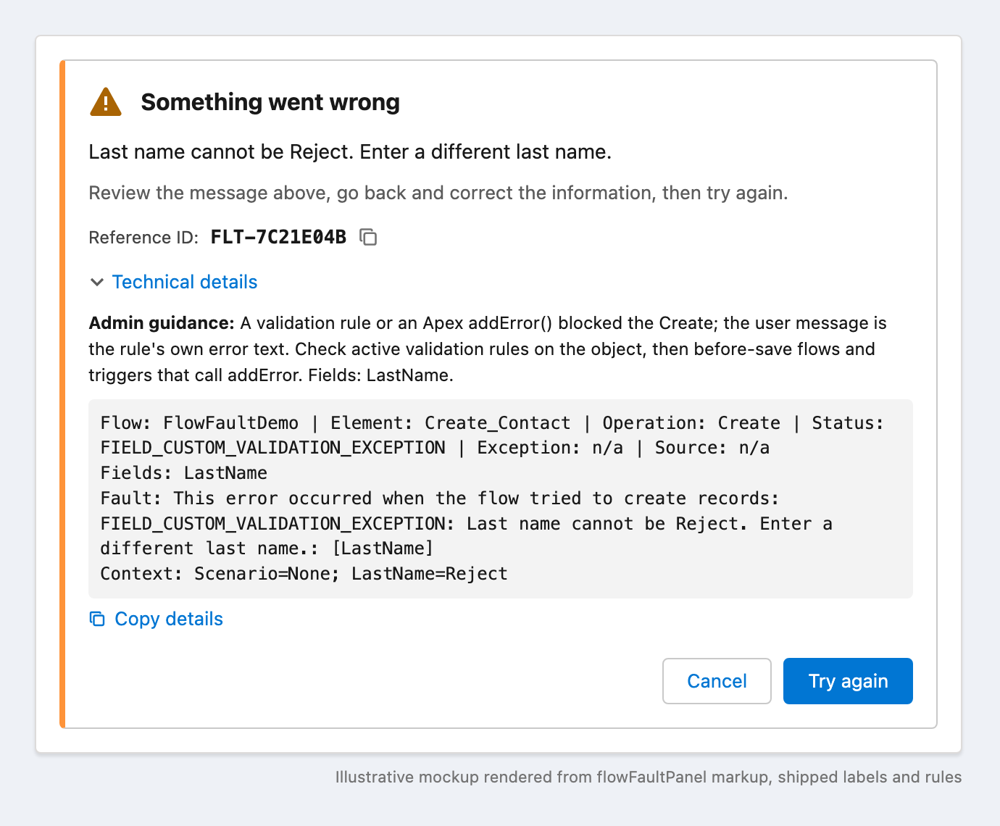
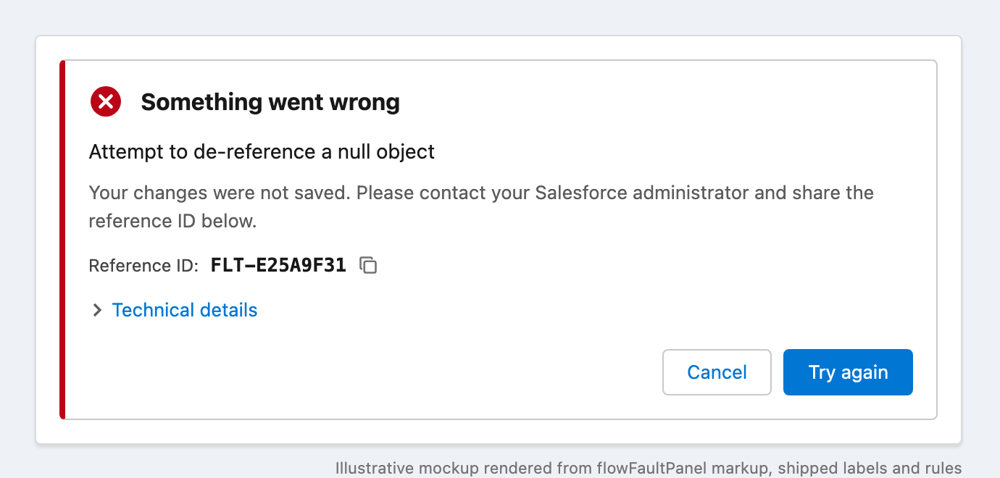
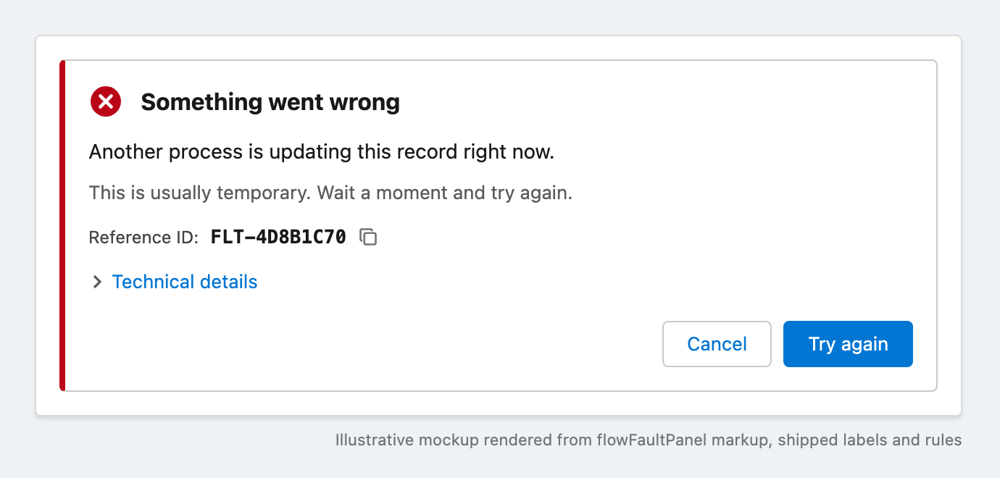
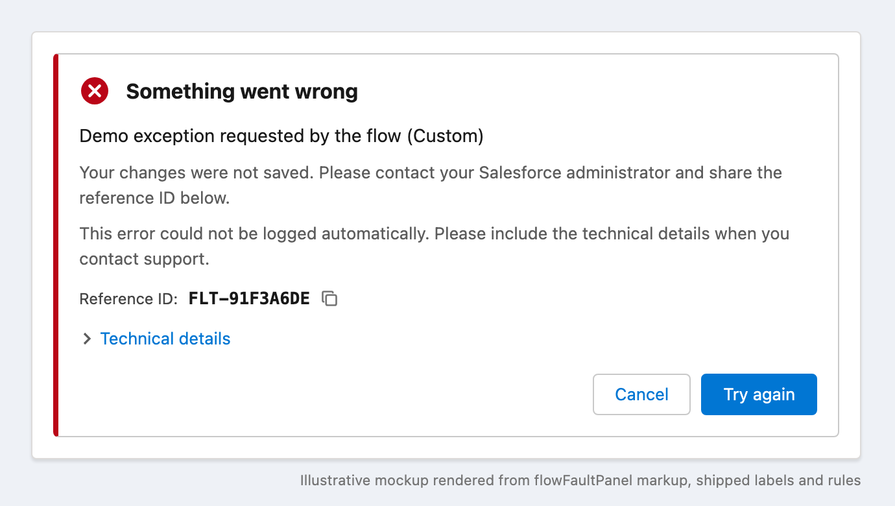

# Demo guide: Flow fault handling

A presenter runbook for showing the Phase 1 framework to admins, developers and delivery leads, plus images for documentation and training. Running time is about 15 minutes, or 25 with the optional segments.

> DRAFT: AI-generated with Claude Code. Review and verify before you present it or reuse it in client material (Steampunk AI policy). Run the demo in a **sandbox or scratch org only**, never in an org that holds client data or CUI. All names, IDs and reference IDs below are made up.



## Key messages

1. **One connector, one subflow.** Every fault path in every flow goes to the same handler. No more hand-built error screens, and no more raw `$Flow.FaultMessage` in front of users.
2. **Users get a message they can act on.** A validation rule's own text is shown word for word. A record lock says "try again". Anything else says "contact your admin" and gives a reference ID.
3. **Admins get everything.** The parsed fault, admin guidance and the raw message go to Nebula Logger, searchable by the reference ID the user quotes.
4. **Configuration, not code.** The 27 rules, the wording and the settings live in Custom Metadata and Custom Labels. A new classification is a JSON edit plus a regenerate.
5. **It never hides a failure.** If logging fails, the user is told so and the flow gets `isLogged = false` with the reason.

## Before the demo

Allow about 30 minutes the first time.

### 1. Org

- A sandbox or scratch org with **Nebula Logger** (unlocked package) installed.
- Deploy in order, then run the tests. The commands are in the [README quick start](../README.md#quick-start).
  ```bash
  sf project deploy start --source-dir force-app --target-org <alias>
  ```
  ```bash
  sf project deploy start --source-dir nebula-adapter --target-org <alias>
  ```
  ```bash
  sf project deploy start --source-dir demo --target-org <alias>
  ```
- In **Setup → Flows**, confirm that `FlowFaultHandlerCore`, `FlowFaultHandlerScreen` and `FlowFaultDemo` are active. If they arrived as Draft, activate them in that order.

### 2. Nebula Logger settings for the presenting user

Open the Logger Settings tab (`LoggerSettings__c`) and check the presenting user (or the org default):

| Setting | Value | Why |
|---|---|---|
| Is Enabled | true | Otherwise Nebula drops the entry. |
| Logging Level | `WARN` or lower | Validation and required-field faults log at WARN. At `ERROR`, they are silently dropped and the panel still claims they were logged (review H2). |
| Default Save Method | `EVENT_BUS` | Any other method lets Roll Back Records erase the entry (review H3). |

### 3. Demo validation rule

This makes the best moment in the demo possible: a validation rule's own text shown to the user word for word. It is scoped so that only demo records can trigger it.

Go to **Setup → Object Manager → Contact → Validation Rules → New** and enter:

- **Rule Name:** `FlowFaultDemoRejectLastName`
- **Formula:** `AND(FirstName = "Flow Fault Demo", LastName = "Reject")`
- **Error Message:** `Last name cannot be Reject. Enter a different last name.`
- **Error Location:** Field → Last Name

### 4. Smoke test

```bash
sf apex run --file scripts/apex/simulate-faults.apex --target-org <alias>
```

The debug log should show nine `=== … =>` lines with categories, and each should read `logged: true via NebulaLogger`. Open **Log Entries** in Nebula and confirm that `[FlowFault]` entries appeared. If they did not, fix step 2 before you go on.

### 5. Rehearse and set up tabs

Run every scenario once before the session. Then open these tabs:

1. `FlowFaultDemo` in Flow Builder (the canvas).
2. The flow's run page: **Setup → Flows → Flow Fault Demo → Run**.
3. Nebula **Log Entries**, with a list view filtered to the tag `FlowFault`.
4. `config/fault-rules.json` in your editor.

## Script

### 0. The problem (1 min)

Without a handler, a flow fault shows the user an unhandled-fault screen, and the admin gets an email with the raw message. Or the author hand-builds an error screen that shows `{!$Flow.FaultMessage}` verbatim: object names, IDs, stack traces. The result differs in every flow, and nobody can find the failure afterwards.

### 1. The pattern (2 min): Flow Builder tab



- Point at the three red **fault connectors**. Each goes to a `FlowFaultHandlerScreen` subflow element.
- Open one handler element. Its inputs are `faultMessage = {!$Flow.FaultMessage}`, `flowApiName` and `elementApiName` (both typed literals), and `contextDetails`. That's the whole setup.
- All three handlers feed one decision. **Retry** goes back to the scenario screen, and **Cancel** ends the flow.
- *Say:* "To adopt it, you add a fault connector to every element that can fail, copy this element in, and change one field."

### 2. Required field missing (2 min): run tab

Pick **Create Records with no last name**, then **Next**.



- The amber border and warning icon mean the user can fix the problem. The message names the field. The next steps tell the user to correct the information and try again.
- Point at the **Reference ID**. Every fault gets one, and support uses it to find the log entry.
- Click **Try again**. The flow returns to the scenario screen, so nothing was lost.

### 3. Validation rule, word for word (3 min)

Pick **Create a valid Contact** and type `Reject` as the last name.



- *Say:* "This is the admin's own validation message. We don't paraphrase it."
- Expand **Technical details**:

  

  The admin guidance comes from the rule. The technical block holds the flow, element, operation, status code, fields and the cleaned fault text.
- Click **Try again**, change the last name to `Demo`, then **Next**. The Success screen appears with the new Contact ID. That is the full recovery loop.

### 4. Apex failure (2 min)

Pick **Apex action hits a null pointer**.



- The red border and error icon mean the user can't fix this. The next steps say the changes weren't saved, to contact the admin, and to share the reference ID.
- Click the **copy** icon next to the reference ID, then **Cancel**.
- Optional: run **Apex action throws a custom exception** too. It classifies as `ApexGeneric` rather than `NullPointer`, which shows that rule priority works.

### 5. The admin's view (3 min): Nebula tab

Search Log Entries for the reference ID you just copied, or filter by the tag `FlowFault`. Each entry has:

- the tags `FlowFault`, `FlowFault:<Category>` and the status code
- the scenario (the flow API name), so you can filter per flow
- the message, laid out like this:

```text
[FlowFault] Validation (FIELD_CUSTOM_VALIDATION_EXCEPTION) in FlowFaultDemo @ Create_Contact
Reference ID: FLT-7C21E04B
Rule: ValidationRule | Severity: WARN | User correctable: true | Retryable: false
User message: Last name cannot be Reject. Enter a different last name.
Admin guidance: A validation rule or an Apex addError() blocked the Create; the user message is the rule's own error text. Check active validation rules on the object, then before-save flows and triggers that call addError. Fields: LastName.
Interview GUID: <handler interview GUID>
Context: Scenario=None; LastName=Reject
---
Flow: FlowFaultDemo | Element: Create_Contact | Operation: Create | Status: FIELD_CUSTOM_VALIDATION_EXCEPTION | Exception: n/a | Source: n/a
Fields: LastName
Fault: This error occurred when the flow tried to create records: FIELD_CUSTOM_VALIDATION_EXCEPTION: Last name cannot be Reject. Enter a different last name.: [LastName]
Context: Scenario=None; LastName=Reject
```

*Say:* "Because Nebula publishes the entry immediately, it survives the rollback that undid the user's changes." (This holds with the `EVENT_BUS` save method from setup step 2.)

### 6. Configuration, not code (2 min): editor tab

- In `config/fault-rules.json`, show the `RowLock` rule. Its fields are `matchType: StatusCode`, `isRetryable: true` and a friendly `userMessage`.
- Explain the order of play: the first active rule by `priority` wins, and `Default` (9999) catches everything else, with guidance to add a rule.
- Run `node scripts/generate-rules.js --check` and point out that CI uses it to keep the metadata in step with the JSON.
- Show what a retryable fault looks like (from the smoke test; the demo flow cannot produce a row lock):

  

### 7. Optional: it never hides (3 min)

Show what happens when logging is unavailable.

1. Go to **Setup → Custom Metadata Types → Flow Fault Setting → Default** and set **Log Sink Class** to `FlowFaultDebugLogSink`.
2. Run **Apex action throws a custom exception**.



The panel tells the user the error was not logged and asks for the technical details. The flow also receives `isLogged = false`, so a calling flow can act on it. **Set Log Sink Class back to `FlowFaultNebulaLogSink` afterwards.**

### 8. Other flow types (1 min, talk only)

- Record-triggered and autolaunched flows call `FlowFaultHandlerCore`. It has no screen, so no rollback and no panel.
- After the handler, either **End** (log the fault and let the record save) or add a **Custom Error** element with `{!Handle_Fault.userMessage}` to block the save with a clean message.
- The action is bulk-safe: one rule query and one log write per batch, tested at 200 records.
- Point people to the [adoption guide](adoption-guide.md) and its review checklist.

## Scenario reference

| Scenario (radio option) | Faulting element | Rule → category | Panel | Image |
|---|---|---|---|---|
| Create Records with no last name | `Create_Contact_Missing_Name` | RequiredFieldMissing → RequiredField | warning, correctable | `panel-required-field.png` |
| Create a valid Contact, last name `Reject` | `Create_Contact` | ValidationRule → Validation | warning, rule text word for word | `panel-validation*.png` |
| Create a valid Contact, any other last name | none | none | Success screen | none |
| Apex action throws a custom exception | `Throw_Exception` | ApexGeneric → Apex | error, contact admin | `panel-not-logged.png` (with the debug sink) |
| Apex action hits a null pointer | `Throw_Exception` | NullPointer → Apex | error, contact admin | `panel-apex-error.png` |
| Apex action fails on DML | `Throw_Exception` | RequiredFieldMissing → RequiredField (expected) | warning | none. This fault shape hasn't been confirmed in an org yet (review M19), so check it in rehearsal. |
| `simulate-faults.apex` row lock sample | none | RowLock → RecordLock | error, retryable | `panel-row-lock.png` |

## Know before you present

These are open items from [the code review](reviews/2026-09-12-code-review.md) that an audience may notice. Have an answer ready, or fix them first.

- **The `Context:` line shows in Technical details** (H1). `contextDetails` is described as "logged, never shown", but the technical block includes it, as the expanded validation image shows. Don't put anything sensitive in `contextDetails` in demo flows.
- **Technical details and admin guidance are visible to every user by default** (M7). That's fine for an internal demo. Present the long-term policy as an open design decision.
- **The Apex user message is the exception text** (`Attempt to de-reference a null object`). The `NullPointer` and `ApexGeneric` rules have a blank `userMessage`, so the parsed detail is shown. If the audience pushes back, it's a one-line rule change, which is a good way to show message 4.
- **Nebula settings can make `isLogged` lie** (H2, H3). Setup step 2 avoids this for the demo.

## After the demo

- Delete or deactivate the `FlowFaultDemoRejectLastName` validation rule.
- Confirm that `FlowFaultSetting.Default` still points at `FlowFaultNebulaLogSink`.
- Delete Contacts with the first name `Flow Fault Demo`.
- Leave the demo flow and `FlowFaultDemoAction` out of any deployment to production. `"default": false` in `sfdx-project.json` doesn't keep them out (review M18).

## Images

All images are in [`docs/images/`](images/):

| File | What it shows |
|---|---|
| `architecture.png` / `.svg` | Flow layer, Apex service pipeline, configuration and log sinks |
| `demo-flow.png` / `.svg` | The `FlowFaultDemo` canvas and the outcome of each scenario |
| `panel-required-field.png` | Warning panel: required field |
| `panel-validation.png` | Warning panel: validation rule text word for word |
| `panel-validation-details.png` | The same, with Technical details expanded |
| `panel-apex-error.png` | Error panel: Apex null pointer, contact admin |
| `panel-row-lock.png` | Error panel: retryable record lock |
| `panel-not-logged.png` | Error panel with the "could not be logged" notice |

The panel images are **mockups**. They are rendered from [`images/src/fault-panel-mockup.html`](images/src/fault-panel-mockup.html), which copies the panel's markup, CSS, the shipped Custom Labels and the rule text. They are not screenshots from an org. After the first live run, replace them with real screenshots, or keep the mockups and update their source when wording changes. To rebuild every PNG with the local Chrome (no installs):

```bash
node scripts/render-doc-images.js
```

Pass image names to rebuild only some of them, for example `node scripts/render-doc-images.js panel-row-lock architecture`. Edit the `.svg` files directly to change the diagrams.
